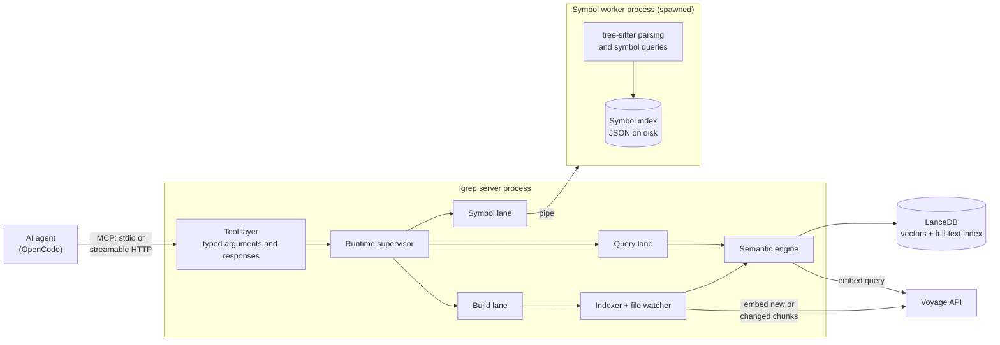

<p align="center">
  <picture>
    <source media="(prefers-color-scheme: dark)" srcset="docs/assets/lgrep-header-dark.svg">
    <source media="(prefers-color-scheme: light)" srcset="docs/assets/lgrep-header-light.svg">
    
  </picture>
</p>

<p align="center">
  <a href="https://github.com/Sharper-Flow/lgrep/actions/workflows/ci.yml"></a>
  <a href="https://github.com/Sharper-Flow/lgrep/releases"></a>
  <a href="https://www.python.org"></a>
  <a href="LICENSE"></a>
</p>

`lgrep` is a code-intelligence server for AI coding agents. It speaks the [Model Context Protocol](https://modelcontextprotocol.io) (MCP). An agent such as [OpenCode](https://github.com/opencode-ai/opencode) uses it to search a codebase by meaning when it does not know a name, and by symbol when it does.

Without it, an agent explores a repository with `glob`, `grep`, and random file reads, and repeats that work in every session. `lgrep` keeps a semantic index and a symbol index on disk between sessions and answers from them. One shared local server can keep both warm for every session. Indexes stay on the machine. The semantic engine sends only queries and the chunks it embeds to the Voyage API. Symbol lookup is fully local and needs no API key.

## At a glance

| | |
|---|---|
| **What** | MCP server with two engines: semantic search and exact symbol lookup |
| **Stack** | Python 3.11–3.13, [Voyage Code 4](https://docs.voyageai.com/) embeddings, [LanceDB](https://lancedb.com), [tree-sitter](https://tree-sitter.github.io/) |
| **Surface** | 22 MCP tools, a CLI, and a one-command OpenCode installer |
| **Languages** | 30+ for semantic chunking, 165+ for symbol parsing |
| **Size** | ~16k lines of source, ~25k lines of tests (1,100+ test functions) |
| **Delivery** | CI on Python 3.11, 3.12, and 3.13; automatic release on every merge to `main` |

## Architecture



**Semantic engine.** lgrep splits files into AST-aware chunks, embeds them with Voyage Code 4, and stores them in a local LanceDB table. A query runs vector search and full-text search, then merges the two rankings with reciprocal rank fusion. Before each search, lgrep checks whether the index has drifted from the files on disk. If it has, the search answers from the current index, marks the response stale, and refreshes the index in the background.

**Symbol engine.** tree-sitter parses each file into symbols, their hierarchy, and identifier occurrences. lgrep stores the result as a compact JSON index per repository. That index serves symbol search, file and repository outlines, source retrieval, and candidate references, with no network call.

**Runtime.** Blocking work never runs on the event loop. A supervisor sends each job to one of three bounded lanes: queries, builds, or symbol work. When a tool call hits its server-side timeout, the supervisor sets the job's cancellation event. Indexing checks that event between steps and also stops at a wall-clock budget, so abandoned work ends and frees its thread. Symbol work runs in a separate spawned process, so its CPU-bound Python never holds the server's global interpreter lock (GIL).

**Cache sharing and cleanup.** Git worktrees of one repository can share one semantic cache. Each worktree then stores only the files that differ from the main checkout. Garbage-collection commands remove orphaned caches, stale symbol indexes, and old LanceDB table versions. MCP tools delete nothing unless the server operator grants it.

## Engineering highlights

One shared lgrep daemon serves many agent sessions at once, on repositories of more than a thousand files. The changes below keep it fast, bounded, and correct under that load. Each one states the measured problem, the fix, and the result recorded in its pull request.

| Problem | Before | After | PR |
|---|---|---|---|
| Symbol index rebuild cost grew with index size for every changed file | 81.6 s cold build, 500 files | 15.1 s | [#53](https://github.com/Sharper-Flow/lgrep/pull/53) |
| Symbol index stored full line text for every identifier | 432 MB index body | 60 MB (86% smaller, identical results) | [#45](https://github.com/Sharper-Flow/lgrep/pull/45) |
| LanceDB kept every table version forever | 9.3 GiB cache, ~270 ms query | 1.7 GiB, ~22 ms | [#50](https://github.com/Sharper-Flow/lgrep/pull/50) |
| Freed native memory stayed in fragmented allocator arenas | idle RSS climbing 1,778 → 2,482 MiB | flat at 697–792 MiB | [#48](https://github.com/Sharper-Flow/lgrep/pull/48) |
| Worktree searches scanned a large path-exclusion filter | 7.8–8.6 s hybrid search | 0.91–0.96 s, same top 10 | [#51](https://github.com/Sharper-Flow/lgrep/pull/51) |
| Symbol builds held the interpreter lock, stalling other tools | text search during a build: 1.14 s worst case | 0.095 s | [#54](https://github.com/Sharper-Flow/lgrep/pull/54) |
| Symbol worker imported the vector database it never uses | 4.1–5.0 s cold start, ~204 MB | 0.14 s, ~73 MB | [#55](https://github.com/Sharper-Flow/lgrep/pull/55) |

### Algorithmic: a quadratic index merge

A profile of a cold symbol build on a 500-file repository spent 108 s of 134 s removing old entries for changed files. The merge rebuilt the whole symbol table and every occurrence bucket once per file, so k files cost k × index size. The merge now indexes symbols and occurrence buckets by source file, so a removal touches only the buckets that hold that file's rows. A cold build fell from 81.6 s to 15.1 s. Merging 100 changed files into a 427 MB index fell from 34.9 s to 1.44 s. The saved index was identical, field for field. ([#53](https://github.com/Sharper-Flow/lgrep/pull/53))

### Storage: a lossless compact encoding for the symbol index

On a 1,154-file repository the symbol index body was 432 MB, because every identifier occurrence stored its full line text. lgrep now writes occurrences in one interned JSON encoding and rebuilds ordinary dictionaries on load. The body shrank 86%, to 60 MB. Every file, symbol, occurrence, and query-result digest stayed identical. Warm reference queries fell from 7.7–8.1 s to 12–17 ms. The trade-off is memory: resident size after a query rose from about 201 MiB to 762 MiB. An older index keeps its format until its next rewrite, which publishes the compact form. ([#45](https://github.com/Sharper-Flow/lgrep/pull/45))

### Storage: table versions nobody deleted

Every LanceDB write leaves a new table version, and nothing deleted the old ones. The semantic cache on one host reached 97 GiB. One 170k-row table held 16,772 versions: 8.0 GiB of manifests beside 2.0 GiB of data. `lgrep gc` now compacts each table, deletes old versions, and retrains the vector index. Vector and hybrid search now re-rank candidates by exact distance. On the retrained index, that lifts top-10 agreement with exact search from 0.60 to 0.98. On a copy of that table, size fell from 9.3 GiB to 1.7 GiB and query time from ~270 ms to ~22 ms. Server connections recheck the latest version every 5 s, so a running server keeps working after another process cleans its tables. ([#50](https://github.com/Sharper-Flow/lgrep/pull/50))

### Memory: native heap fragmentation in a long-lived daemon

After 58 idle hours, the shared daemon held 33 GiB of resident memory plus 27 GiB of swap, while its own caches reported almost nothing. Allocator statistics showed about 1,500 fragmented 64 MiB glibc heap arenas, left behind by LanceDB scans. The fix caps malloc arenas at startup, returns free heap to the OS on a timer after work finishes, and shares one bounded LanceDB session across all stores. In a 10-cycle probe over three real caches, idle memory stayed flat at 697–792 MiB. Under the old code it climbed from 1,778 to 2,482 MiB. `lgrep_diagnostics` now reports these figures. ([#48](https://github.com/Sharper-Flow/lgrep/pull/48))

### Concurrency: one daemon, many sessions

- **Cooperative cancellation.** A search that timed out abandoned its auto-index thread, which kept running and held its worker. Enough abandoned threads wedged the pool for good. A cancellation event now reaches every blocking step of that indexing path, including the embedding retry sleep. A wall-clock budget backs it up. An abandoned job on a 2,157-file repository now ends and frees its worker. ([#3](https://github.com/Sharper-Flow/lgrep/pull/3))
- **Lanes and off-loop I/O.** Six tool calls ran 41–71 s, well past their timeout. The first LanceDB I/O on each store ran synchronously on the event loop, so the timeout never fired. Stores now open on worker threads, and index builds have their own lane, so queries no longer wait behind builds. ([#28](https://github.com/Sharper-Flow/lgrep/pull/28))
- **Process isolation for CPU-bound work.** Symbol builds and queries are CPU-bound Python and hold the GIL. All symbol work now runs in one persistent spawned worker. If the worker crashes, the next call starts a new one, and the calls in flight return a retryable error. During a full symbol build, the slowest overlapping text search fell from 1.143 s to 0.095 s ([#54](https://github.com/Sharper-Flow/lgrep/pull/54)). A follow-up deferred the storage package's vector-database imports until first use, so the worker never imports LanceDB. Worker cold start fell from 4.1–5.0 s to 0.14 s, and worker memory from ~204 MB to ~73 MB ([#55](https://github.com/Sharper-Flow/lgrep/pull/55)).
- **Fast startup.** MCP `initialize` waited until every warm-up path had opened its store. With five paths that took 9.99 s and tripped the host's spawn deadline. Warm-up now runs in the background, and `initialize` answers in 2.45 s. ([#49](https://github.com/Sharper-Flow/lgrep/pull/49))

### Correctness: worktrees and embedding provenance

- **Per-worktree views of one cache.** With a shared cache, every git worktree used to search the first checkout's files. Rows now carry a checkout column, and each worktree stores overlay rows only for files that differ from the main checkout ([#26](https://github.com/Sharper-Flow/lgrep/pull/26)). Worktree searches then filtered with a large path-exclusion list. A later change replaced it with a checkout prefilter plus over-fetch. Hybrid search fell from 7.8–8.6 s to 0.91–0.96 s with the same top 10 ([#51](https://github.com/Sharper-Flow/lgrep/pull/51)).
- **Model provenance.** Voyage Code 3 and Code 4 both emit 1024-dimensional vectors. An index built by the old model therefore loads without error, but its vectors cannot be compared with new query vectors. Every chunk now records the model that embedded it. lgrep rebuilds a table with a mismatched model on first use instead of searching it. ([#14](https://github.com/Sharper-Flow/lgrep/pull/14))

### How changes ship

Each change above landed as a pull request that records the problem, the evidence, and the verification. CI runs Ruff and the full test suite on every pull request. A successful CI run on `main` publishes a release.

## Quick start

Requirements: Python 3.11+, and a [Voyage API key](https://dash.voyageai.com/) for the semantic engine only.

```bash
# From GitHub
pip install git+https://github.com/Sharper-Flow/lgrep.git

# Or from a source checkout
git clone https://github.com/Sharper-Flow/lgrep.git
cd lgrep && pip install .

# Try it without an agent
lgrep index-symbols /path/to/project
lgrep search-symbols "authenticate" /path/to/project
export VOYAGE_API_KEY=your-key
lgrep index-semantic /path/to/project
lgrep search-semantic "where are sessions validated" /path/to/project
```

## OpenCode setup

**stdio is the local default**, for one user and one session. OpenCode starts lgrep itself, so no separate server process runs. For many sessions, use the shared HTTP server below.

### 1. Run the installer

```bash
lgrep install-opencode
```

The installer is safe to run more than once. It:

- creates `~/.cache/lgrep/` for indexes and logs
- copies the packaged `instructions/lgrep-tools.md` and `skills/lgrep/SKILL.md` into `~/.config/opencode/`
- appends the instruction file to the `instructions` array so agents try `lgrep` first
- adds a `type: "remote"` MCP entry pointing at `http://localhost:6285/mcp` (the shared HTTP server)
- edits `~/.config/opencode/opencode.json`, or `opencode.jsonc` when only that file exists; it keeps every config value but rewrites the file as plain JSON, which drops any comments from `opencode.jsonc`
- prints systemd user-service and manual-daemon instructions for the shared server

`lgrep uninstall-opencode` removes the MCP entry, the instruction entry, and the skill file.

### 2. Choose a transport

For stdio (local default), replace the `mcp.lgrep` entry with:

```json
{ "mcp": { "lgrep": { "type": "local", "command": ["lgrep"], "enabled": true } } }
```

OpenCode requires `command` for a `local` entry ([OpenCode MCP docs](https://opencode.ai/docs/mcp-servers/)). Put `VOYAGE_API_KEY` in its `environment` object, or in the environment OpenCode starts from.

For the **shared HTTP** server, keep the installer's `remote` entry and start one warm server that handles every session:

```bash
VOYAGE_API_KEY=your-key \
LGREP_WARM_PATHS=/path/to/project-a:/path/to/project-b \
lgrep --transport streamable-http --host 127.0.0.1 --port 6285
```

```json
{ "mcp": { "lgrep": { "type": "remote", "url": "http://localhost:6285/mcp", "enabled": true } } }
```

Optional: `lgrep init-ignore /path/to/project` creates a `.lgrepignore`. lgrep always respects `.gitignore` as well. Cache maintenance, worktree cache sharing, and daemon tuning are covered in [docs/operations.md](docs/operations.md). A complete config example is in [examples/opencode.json](examples/opencode.json).

The active agent profile must also allow the lgrep tools. A profile that allows only `read`, `glob`, and `grep` cannot call lgrep, even with the server configured.

## First use

1. Ask an intent question: `search_semantic(query="authentication flow", path="/path/to/project")`. A project with no index is indexed on its first search.
2. Inspect structure: `get_file_outline(path=...)` or `get_repo_outline(path=...)`.
3. Retrieve exact symbols: `search_symbols(...)`, then `get_symbol(symbol_id="src/auth.py:function:authenticate", path=...)`.
4. List candidate usages, bounded and not exhaustive: `search_references(query="authenticate", path=...)`.

Symbol IDs are deterministic `file_path:kind:name` strings, for example `src/auth.py:class:AuthManager` or `src/auth.py:method:login`.

## Reference

The server registers the names below, and MCP clients receive them unchanged. OpenCode displays each one with the server key as a prefix: with an MCP entry named `lgrep`, `search_semantic` appears as `lgrep_search_semantic`. Only `lgrep_diagnostics` has the prefix in its registered name. Response shapes and argument rules are in [docs/operations.md](docs/operations.md#mcp-response-format).

<details>
<summary><strong>MCP tools</strong> (22)</summary>

### Semantic tools

| Tool | Purpose |
|---|---|
| `search_semantic(query, path, limit=10, hybrid=true, include_content=false)` | Search code by natural-language meaning |
| `index_semantic(path)` | Build or refresh the semantic index |
| `status_semantic(path="")` | Index/watcher status; omit `path` for all loaded projects |
| `watch_start_semantic(path)` | Start background re-indexing on file changes |
| `watch_stop_semantic(path="")` | Stop one watcher or all |

### Symbol tools

| Tool | Purpose |
|---|---|
| `index_symbols_folder(path, max_files=500, incremental=true)` | Submit a local symbol-index job (stdio only) |
| `index_symbols_repo(repo, ref="HEAD", max_files=500, github_token=None)` | Submit a GitHub API symbol-index job (stdio only), no clone |
| `get_symbol_index_job(job_id)` | Read job state and final counters/truncation in the current daemon |
| `list_repos()` | List indexed symbol repos |
| `get_file_tree(path, max_files=500)` | Repo file tree with ignore rules applied |
| `get_file_outline(path, repo_root=None)` | Symbol outline for one file |
| `get_repo_outline(path, max_files=500)` | Symbol outlines across a repo |
| `search_symbols(query, path, limit=20, kind=None)` | Search symbols by name (case-insensitive substring) |
| `search_text(query, path, limit=50, case_sensitive=false)` | Search literal text |
| `search_references(query, path, limit=20, usage_filter="production_first", kind=None)` | Bounded candidate usages; not compiler-exhaustive |
| `get_symbol(symbol_id, path)` | One symbol's metadata and source |
| `get_symbols(symbol_ids, path)` | Batch symbol retrieval |
| `invalidate_cache(path)` | Drop one repo's symbol index; needs the destructive-MCP grant |

### Maintenance and diagnostics

| Tool | Purpose |
|---|---|
| `prune_orphans(dry_run=true)` | Preview (or delete) orphan semantic cache dirs |
| `prune_symbols(dry_run=true)` | Preview (or delete) stale symbol-store indexes |
| `invalidate_worktree_cache(paths)` | Remove a worktree's cache alias and overlay rows |
| `lgrep_diagnostics()` | Read-only daemon snapshot: PID, uptime, projects, jobs |

Prune and invalidate tools refuse to delete without the server-side `LGREP_ALLOW_DESTRUCTIVE_MCP` grant; the pruners also skip projects loaded in the running server.

</details>

<details>
<summary><strong>CLI commands</strong></summary>

| Command | Purpose |
|---|---|
| `lgrep` | Start the MCP server: `--transport {stdio,streamable-http}` (default `stdio`), `--host` (default `127.0.0.1`), `--port` (default `6285`) |
| `lgrep --version` | Print the version |
| `lgrep search-semantic <query> [path]` | One-shot semantic search; `-m/--limit N`, `--no-hybrid` |
| `lgrep index-semantic [path]` | One-shot semantic index; `--chunk-size N` |
| `lgrep search-symbols <query> [path]` | One-shot symbol search; `-m/--limit N`, `--storage-dir DIR` |
| `lgrep index-symbols [path]` | Index symbols; `--storage-dir DIR`, `--max-files N` |
| `lgrep init-ignore [path]` | Create a recommended `.lgrepignore`; `--force` |
| `lgrep prune-orphans` | Inspect or delete orphan semantic caches; `--execute`, `--dry-run`, `--cache-dir DIR` |
| `lgrep prune-symbols` | Inspect or delete stale symbol indexes; `--execute`, `--dry-run`, `--storage-dir DIR` |
| `lgrep gc` | Combined GC: orphans + worktree aliases + symbol indexes + chunk-table optimize; `--execute`, `--dry-run`, `--cache-dir DIR`, `--symbols-dir DIR` |
| `lgrep remove <path>` | Show on-disk index info for a project |
| `lgrep install-opencode` | Install into OpenCode (MCP entry + instruction + skill) |
| `lgrep uninstall-opencode` | Remove lgrep from OpenCode |

`search` and `index` are aliases for `search-semantic` and `index-semantic`; `init-lgrepignore` aliases `init-ignore`. Prune commands are dry-run by default and `--execute`/`--dry-run` are mutually exclusive.

</details>

<details>
<summary><strong>Environment variables</strong></summary>

| Variable | Default | Description |
|---|---|---|
| `VOYAGE_API_KEY` | none | Required for semantic search; the symbol engine works without it |
| `LGREP_LOG_LEVEL` | `INFO` | Log verbosity |
| `LGREP_LOG_FILE` | unset | Opt-in rotating JSON log file; see [operations](docs/operations.md#notes-on-selected-environment-variables) |
| `LGREP_CACHE_DIR` | `~/.cache/lgrep` | Semantic cache directory |
| `LGREP_SYMBOLS_DIR` | `~/.cache/lgrep/symbols` | Directory that `prune-symbols`, `lgrep gc`, and the MCP `prune_symbols` tool scan. Indexing and symbol queries use the default directory; the CLI `index-symbols` and `search-symbols` commands take `--storage-dir` instead |
| `LGREP_WARM_PATHS` | none | Colon-separated projects to warm on startup |
| `LGREP_AUTO_WARM_DISK` | `true` | Auto-load discoverable disk caches at startup when no warm paths are set; set `false` on large shared machines |
| `LGREP_AUTO_WATCH` | `false` | Auto-start file watchers for warmed projects |
| `LGREP_TOOL_TIMEOUT_S` | `45` | Per-tool server-side timeout (seconds) |
| `LGREP_EXPLICIT_INDEX_BUDGET_S` | `150` | Cooperative budget for explicit symbol-index jobs, independent of the tool timeout; positive finite overrides only |
| `LGREP_STALENESS_DEADLINE_S` | `4.0` | Bound on the per-search staleness check |
| `LGREP_ENSURE_BUDGET_S` | `8.0` | Budget for a worktree search to make its trunk base index current; `0` always defers to the background |
| `LGREP_INDEX_MAX_WALL_S` | `60.0` | Wall-clock budget per indexing window |
| `LGREP_AUTO_REFRESH` | `1` | `0` opts out of the symbol-index freshness gate that refreshes a stale index before `search_symbols` answers |
| `LGREP_GITHUB_TOKEN` | unset | Token for `index_symbols_repo` when the call passes none |
| `GITHUB_TOKEN` | unset | Fallback when `LGREP_GITHUB_TOKEN` is unset; an explicit argument wins over both |
| `LGREP_WORKER_MAX_THREADS` | `4` | Query-lane worker threads for supervised blocking jobs |
| `LGREP_BUILD_MAX_THREADS` | `1` | Shared build-lane threads: semantic index windows, re-indexes, prune sweeps; explicit symbol jobs have a separate one-worker lane |
| `LGREP_PRUNE_MIN_AGE_S` | `3600` | Grace window (seconds) before pruning; `0` disables grace |
| `LGREP_WORKTREE_DEDUP` | unset | Any non-empty value makes git worktrees of one repo share one semantic cache |
| `LGREP_ALLOW_DESTRUCTIVE_MCP` | unset | `true`/`1`/`yes` lets MCP prune/invalidate tools delete; keep unset on any shared server |

</details>

## Transport and security

`lgrep` supports two transports: `stdio` and `streamable-http`. stdio is the local default and suits one session. Use streamable HTTP only when you want one shared local daemon.

Explicit symbol-index jobs require stdio. Both submission tools return a `job_id`, not final counters; call `get_symbol_index_job` before using their results. Two limits can stop a run: `max_files` caps the file count, and a separate cooperative job budget, 150 seconds by default, caps the time. Status reports `truncation_reason` as `"max_files"`, `"deadline"`, or null. A truncated run does not cover the whole repository. See [job ownership and recovery](docs/operations.md#explicit-symbol-index-jobs).

- The HTTP server binds `127.0.0.1` by default and has no built-in authentication.
- lgrep sets no CORS headers. Do not connect browser-based clients directly to the streamable-HTTP endpoint.
- Behind a proxy, enforce your own authentication and origin controls there.
- lgrep binds `0.0.0.0` only when you pass that host explicitly. Do not do it without a reverse proxy or firewall.

## Troubleshooting

- **`VOYAGE_API_KEY` not set** — set it in the MCP server environment; the symbol engine still works without it.
- **Slow first semantic index** — the first run embeds the whole project; later runs skip unchanged files by content hash.
- **`Repository not indexed`** — for a local git checkout, symbol tools build the index on the first query. A query on a subdirectory needs an explicit `index_symbols_folder`. Details in [operations](docs/operations.md#freshness-and-index-budgets).
- **Stale semantic results** — a search answers from the current index, sets `is_stale: true` when that index has drifted, and refreshes it in the background. Run `index_semantic` to force a fresh index before a query. See [operations](docs/operations.md#freshness-and-index-budgets).
- **Diagnosing high CPU or memory on a shared daemon** — call `lgrep_diagnostics` for PID, worker limit, active jobs, and process memory; see [shared-daemon tuning](docs/operations.md#shared-daemon-tuning-vision--opencode).
- **Native dependency build fails** — prebuilt wheels usually work; otherwise install a compiler toolchain.

Since `3.0.0`, every MCP tool returns structured dicts instead of JSON strings. To upgrade from `2.x`, see [Upgrade from 2.x](CHANGELOG.md#upgrade-from-2x).

## Development

```bash
git clone https://github.com/Sharper-Flow/lgrep.git
cd lgrep
pip install -e ".[dev]"
pytest -v
ruff check . && ruff format --check .
```

Design specifications are in [docs/specs/](docs/specs/), and operational detail is in [docs/operations.md](docs/operations.md). Release notes are on the [releases page](https://github.com/Sharper-Flow/lgrep/releases).

## License

MIT — see [LICENSE](LICENSE).
